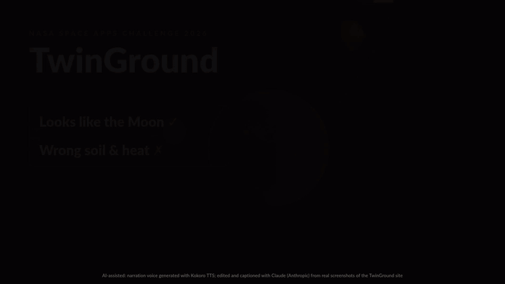
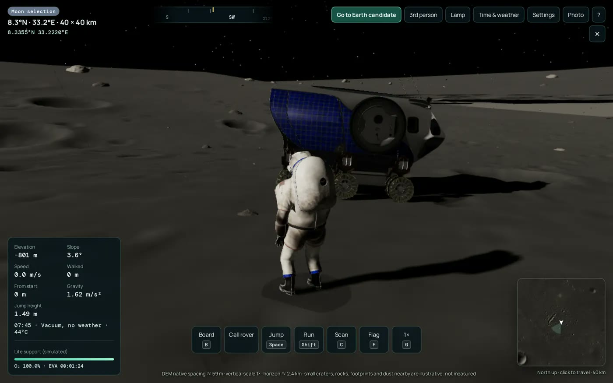
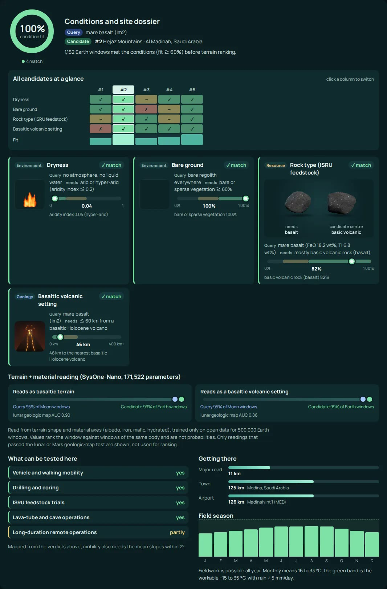
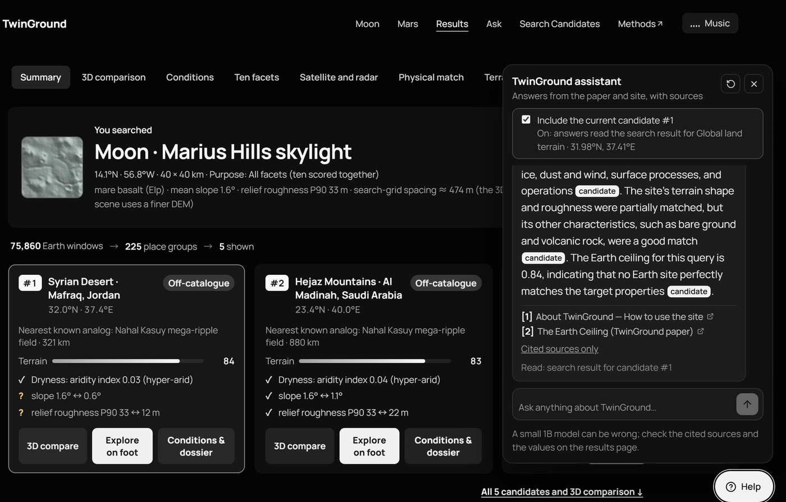
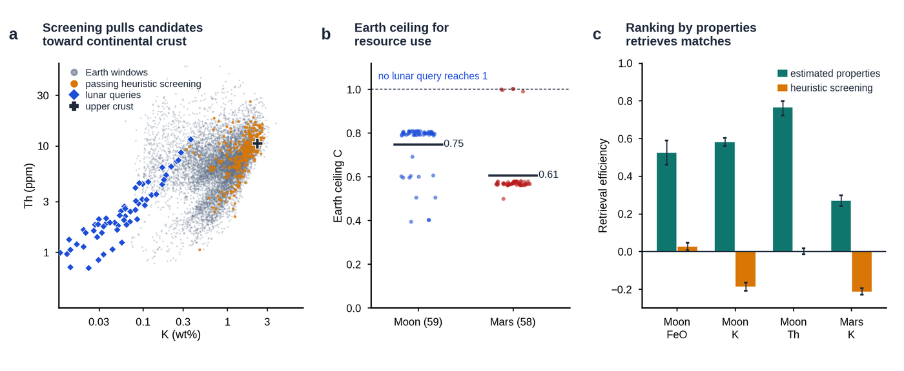

# TwinGround

**Find the places on Earth that best match any site on the Moon or Mars, and see what Earth cannot match.**

NASA Space Apps Challenge 2026 · *Identify Earth Locations that Analog the Permanent Moon Base Locations and Mars*

**[Live site](https://twinground.theminimallab.com)** · **[Video](VIDEO_URL)** · **[Space Apps project page](SPACE_APPS_URL)** · **[Methods paper](https://twinground.theminimallab.com/technology/paper-en.html)**

<!-- TODO: replace VIDEO_URL (YouTube) and SPACE_APPS_URL (Space Apps project page) once they are published. -->



## Why it matters

Rovers, oxygen plants, habitats and crews for Artemis and Mars are tested on Earth before they fly. Test sites are usually chosen by setting: dry, bare, basaltic, volcanic. Nobody had measured how close those places are to a given lunar or Martian site, or how close any place on Earth could be. TwinGround answers both with NASA orbital data, so a team knows which tests a field site can cover and which need a simulant or test chamber.

## What TwinGround does

Pick a 20, 40 or 80 km window on a 3D Moon or Mars globe, or describe a site in plain English. TwinGround reads the window's properties from NASA orbital data and ranks same-size Earth windows for the use you choose, showing which properties match, which differ, and which Earth cannot reach.

- **Game mode.** A guided, voiced mission: find the Moon's lava tube on Earth, compare the terrain, ask the assistant, then walk both sites.
- **Search Candidates.** Browse Earth sites found far from the known analog catalogue, with their targets and scores.
- **Side-by-side 3D terrain and astronaut explorer.** Compare both sites in 3D, then walk either one under its own gravity and teleport between them.
- **Site dossier.** Aridity, rock type, what can be tested, the best field season, and the nearest road, town and airport.
- **Ask assistant.** A chat on every page answers questions, explains why a candidate was chosen, and cites sources.



<p align="center">
  
  
</p>

## What we found

Our study defines the **Earth ceiling**: the best score any measured place on Earth can reach for a lunar or Martian site and use. Across 117 query windows:

- **Terrain is easy to match.** Kilometre-scale roughness can be matched on Earth for every target (mobility ceiling 1.0 for all 117 queries).
- **Surface chemistry and extreme cold are not.** No Earth regolith window matches lunar FeO, TiO₂, K and Th together (mean lunar resource ceiling 0.75). Martian FeO exceeds every measured Earth topsoil footprint (52 of 52 queries), and for 8 of 18 named Martian sites no Earth surface comes within 20 K of the modelled night temperature.
- **Choosing by setting drifts the wrong way.** Screening for "arid, bare, basaltic" finds catalogued analog sites 12.2× more often, but pulls candidates toward potassium- and thorium-rich continental crust in all 20 distinct pools. Property-based ranking reaches a retrieval efficiency of 0.52–0.77 (lunar FeO, K, Th), against −0.19 to 0.02 for setting-based screening.



## How it works

- NASA orbital data and Earth surveys are converted to the same properties, units and footprint size (FeO, TiO₂, K, Th, albedo, roughness, day and night temperature).
- 484,015 Earth land windows (20, 40 and 80 km) are encoded in advance, so each search covers every Earth window of the same size.
- Candidates are ranked for four uses (ISRU feedstock, mobility, thermal environment, base siting) plus a lava-tube search, with fixed, readable weights.
- Each candidate gets a dossier: sourced measurements, condition verdicts, logistics and NASA data links.
- The Ask assistant is Meta Llama 3.2 1B, fine-tuned by the team on 10,220 dialogues, with retrieval over the paper and its cited works. It explains results; it never ranks sites.

Full method and limitations: the **[Methods paper](https://twinground.theminimallab.com/technology/paper-en.html)**.

## Data sources

- **NASA, Moon and Mars:** Lunar Reconnaissance Orbiter (LOLA, LROC, Diviner, Mini-RF), Lunar Prospector, Mars Odyssey, Mars Global Surveyor (MOLA, TES) and Mars Reconnaissance Orbiter (CRISM, HiRISE, CTX), via the [PDS Geosciences Node](https://pds-geosciences.wustl.edu/) and [USGS Astrogeology](https://astrogeology.usgs.gov/); the [SVS CGI Moon Kit](https://svs.gsfc.nasa.gov/4720) and [NASA 3D Resources](https://science.nasa.gov/3d-resources/).
- **NASA, Earth:** MODIS, [NASA POWER](https://power.larc.nasa.gov/), [Earthdata](https://www.earthdata.nasa.gov/) and [Worldview / GIBS](https://worldview.earthdata.nasa.gov/).
- **Other sources:** JAXA SELENE; ESA Mars Express (OMEGA, HRSC); Mars Climate Database (LMD); NOAA ETOPO 2022; USGS; Geoscience Australia; [GEOROC](https://georoc.eu/); [GLASS](https://glass.hku.hk/); Copernicus DEM and Sentinel (ESA / EU); ESA WorldCover; SoilGrids; Smithsonian Global Volcanism Program; RADARSAT (Canadian Space Agency, Natural Resources Canada).
- **Display only:** Esri World Imagery (Esri, Vantor, Earthstar Geographics), proprietary and credited on screen, drapes the Earth terrain but never enters scoring.

Full credits: the paper's [Data credits](https://twinground.theminimallab.com/technology/paper-en.html#credits).

## Built with

React 19, Three.js, Motion and Vite; Python, NumPy, SciPy, scikit-learn, Rasterio and PyTorch; Hugging Face Transformers; one NVIDIA L4 cloud VM behind Cloudflare.

**AI use:** the assistant and plain-English search run Meta Llama 3.2 1B, fine-tuned by the team and self-hosted, with Microsoft multilingual-e5-base retrieval (US-origin open-weight models). The video's narration used Kokoro TTS; Claude (Anthropic) edited and captioned it from real site screenshots.
<!-- TODO: state here whether AI coding assistants were used to write the code. -->

## Run it locally

To try TwinGround, use the [live site](https://twinground.theminimallab.com). Running it yourself needs the prepared data (about 71 GB) and model weights, which are not in this repository.

```bash
ln -s /path/to/twinground-data data      # prepared data, not included
pip install -r requirements.txt
cd web && npm ci && npm run build && cd ..
python web_server.py                      # http://localhost:8765
```

For front-end work, `npm run dev` in `web/` starts Vite and forwards `/api` to port 8765. Maintainer notes: [architecture](docs/architecture.md), [deployment](docs/deployment.md), [assistant](docs/assistant.md).

## Repository layout

| Path | What it is |
|---|---|
| `web/` | React + Three.js front end and static pages, including the Methods paper |
| `web_server.py`, `server/` | Python HTTP server and search pipeline |
| `src/` | Data access, observations and the terrain encoder |
| `scripts/` | Ranking, evidence, chat search and the site assistant |
| `docs/` | Maintainer notes and README images |

## Team

<!-- TODO: add team member names, roles and GitHub links. -->
TODO: team members.

## License

License: TBD. <!-- TODO: choose a license and add a LICENSE file. -->

## Acknowledgments

Built for the NASA International Space Apps Challenge 2026, with thanks to every data provider listed above. TwinGround is not an official NASA product and is not endorsed by NASA.
